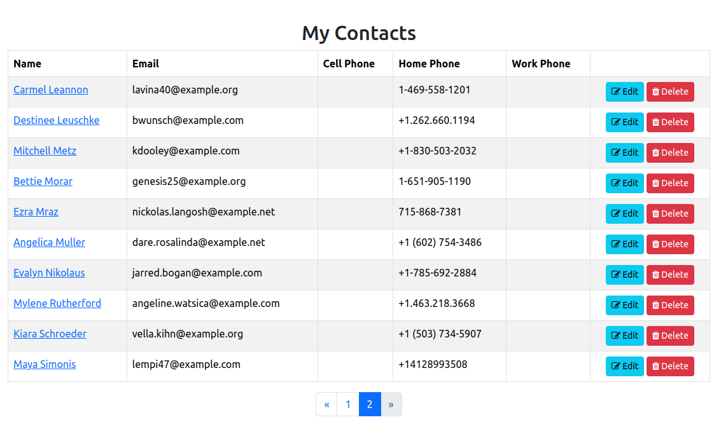

<h1 style="font-size: 50px; text-align: center;">Pagination</h1>

## Table of contents
1. [Overview](#overview)
2. [Basic Pagination](#basic-pagination)
    * A. [Import Pagination Class](#import-class)
    * B. [Create The Pagination Object](#create-pagination)
    * C. [Retrieve Paginated Records](#paginated-records)
    * D. [Adding Pagination To The View](#view)
    * E. [Complete Example](#basic-example)
3. [Search, Filtering, and Sorting](#search-filter)
    * A. [Building a SearchFilter](#building-filter)
    * B. [Searchable Columns](#searchable)
    * C. [Filterable Columns](#filterable)
    * D. [JSON Array Columns](#json-columns)
    * E. [Custom Filters](#custom-filters)
    * F. [Sortable Columns](#sortable)
    * G. [Using The Filter In A Controller](#filter-controller)
    * H. [Search Form And Sortable Headers](#filter-view)
    * I. [Security](#security)
4. [Rendering and Layouts](#rendering)
    * A. [Bootstrap](#bootstrap)
    * B. [Tailwind](#tailwind)
    * C. [Custom View Partial](#view-renderer)
    * D. [Custom Renderer Class](#custom-renderer)
    * E. [Changing The Default Renderer](#default-renderer)
    * F. [Link Options](#link-options)
5. [React Support](#react)
    * A. [How It Works](#react-how)
    * B. [Controller](#react-controller)
    * C. [Building Props](#react-props)
    * D. [Page Component](#react-page)
    * E. [Pagination Component](#react-pagination)
    * F. [PaginationSummary Component](#react-summary)
    * G. [SortableTh Component](#react-sortable)
    * H. [usePaginatedQuery Hook](#react-hook)
6. [Supporting PHP and React Views Together](#both)
7. [Testing](#testing)
8. [API Reference](#api)
    * A. [Pagination](#api-pagination)
    * B. [SearchFilter](#api-filter)
    * C. [JSON Shapes](#api-json)
9. [Upgrading From Earlier Versions](#upgrading)

<br>

## 1. Overview <a id="overview"></a><span style="float: right; font-size: 14px; padding-top: 15px;">[Table of Contents](#table-of-contents)</span>
Pagination splits long lists of records into pages and renders the links used to move between them. Support is built from three parts that can be used together or on their own:

- **`Pagination`** - Tracks the current page, page size, and total number of records. It calculates the limit and offset for your query, builds page links, and renders the controls.
- **`SearchFilter`** - Turns search terms, filters, and sort options from the request into query parameters. Columns must be whitelisted by the developer, and every value goes through bound parameters.
- **Renderers** - Control what the page links look like. Bootstrap 5 is the default. Tailwind, a custom view partial, or your own renderer class can be used instead.

Both PHP views and React views are supported. React pages use the `Pagination`, `PaginationSummary`, and `SortableTh` components along with the `usePaginatedQuery` hook.

An example is shown below in Figure 1.

<div style="text-align: center;">
  
  <p style="font-style: italic;">Figure 1 - Pagination example</p>
</div>
<br>

## 2. Basic Pagination <a id="basic-pagination"></a><span style="float: right; font-size: 14px; padding-top: 15px;">[Table of Contents](#table-of-contents)</span>
The following are instructions for setting up pagination within your controller. We will use the `indexAction` of the `ContactsController`.

#### A. Import Pagination Class <a id="import-class"></a>

```php
use Core\Lib\Pagination\Pagination;
```
<br>

#### B. Create The Pagination Object <a id="create-pagination"></a>
`Pagination::fromRequest()` reads the `page` value from the request and creates the object in one step. It accepts three parameters:
1. `$request` - The request object.
2. `$limit` - The maximum number of records per page.
3. `$totalItems` - The total number of records in the list.

We use [findTotal](database_queries#find-total) to count the contacts that belong to the current user.

```php
$pagination = Pagination::fromRequest($this->request, 10, Contacts::findTotal([
    'conditions' => 'user_id = ?',
    'bind'       => [$this->currentUser->id]
]));
```

The page number is validated before it is used. A missing or invalid value such as `?page=abc` or `?page=-2` becomes page 1, and a page past the end such as `?page=999` becomes the last page.

<br>

#### C. Retrieve Paginated Records <a id="paginated-records"></a>
Use the `paginationParams` function to build the query for the model's `find` function. It adds the limit and offset for the current page.

```php
$contacts = Contacts::find($pagination->paginationParams(
    'user_id = ?',                  // Conditions
    [$this->currentUser->id],       // Bind
    'lname, fname'                  // Order
));
```
<br>

#### D. Adding Pagination To The View <a id="view"></a>
Pass the `Pagination` object to the view:

```php
$this->view->pagination = $pagination;
```

Within your view, add the following line where the page links should appear. In this case, it goes right after the closing tag for the table element:

```php
<?= $this->pagination->render() ?>
```

Nothing is rendered when all records fit on one page.

<br>

#### E. Complete Example <a id="basic-example"></a>
Putting everything together, here is the complete `indexAction` function:

```php
public function indexAction(): void {
    $pagination = Pagination::fromRequest($this->request, 10, Contacts::findTotal([
        'conditions' => 'user_id = ?',
        'bind'       => [$this->currentUser->id]
    ]));

    $contacts = Contacts::find($pagination->paginationParams(
        'user_id = ?',
        [$this->currentUser->id],
        'lname, fname'
    ));

    $this->view->contacts = $contacts;
    $this->view->pagination = $pagination;
    $this->view->render('contacts.index');
}
```

And the view:

```php
<?php $this->setSiteTitle("My Contacts"); ?>

<?php $this->start('body'); ?>
<h2 class="text-center">My Contacts</h2>
<table class="table table-striped table-bordered table-hover">
    <thead>
        <th>Name</th>
        <th>Email</th>
        <th>Cell Phone</th>
        <th></th>
    </thead>
    <tbody>
        <?php foreach($this->contacts as $contact): ?>
            <tr>
                <td>
                    <a href="<?=route('contacts.details', [$contact->id])?>">
                        <?= $contact->displayName(); ?>
                    </a>
                </td>
                <td><?= $contact->email ?></td>
                <td><?= $contact->cell_phone ?></td>
                <td class="text-center">
                    <a href="<?=route('contacts.edit', [$contact->id])?>" class="btn btn-info btn-sm">
                        <i class="fa fa-edit"></i> Edit
                    </a>
                </td>
            </tr>
        <?php endforeach; ?>
    </tbody>
</table>

<?= $this->pagination->render() ?>
<?php $this->end(); ?>
```

<br>

## 3. Search, Filtering, and Sorting <a id="search-filter"></a><span style="float: right; font-size: 14px; padding-top: 15px;">[Table of Contents](#table-of-contents)</span>
The `SearchFilter` class reads the search term, filters, and sort order from the request and turns them into the `conditions`, `bind`, and `order` parameters used by `find` and `findTotal`. The same filter is used for both the count and the page query, so the total always matches the results.

The examples in this section come from the admin dashboard's user list.

#### A. Building a SearchFilter <a id="building-filter"></a>
Following the [service layer](services) pattern, build the filter in a service so the controller stays thin:

```php
use Core\Lib\Pagination\SearchFilter;
use Core\Models\ACL;

public static function userFilter(object $request): SearchFilter {
    return SearchFilter::fromRequest($request)
        ->where('id != ?', [AuthService::currentUser()->id])
        ->searchable(['username', 'email', 'fname', 'lname'])
        ->filterable(['inactive' => array_keys(self::STATUS_OPTIONS)])
        ->filterJsonContains('acl', array_keys(ACL::getOptionsForForm()))
        ->sortable(['username', 'acl', 'inactive', 'created_at', 'updated_at'], 'created_at', 'desc');
}
```

`where()` adds a condition that always applies. In this case it excludes the current user. It can be called more than once.

<br>

#### B. Searchable Columns <a id="searchable"></a>
`searchable()` lists the columns matched against the search term. The term is read from the `q` query parameter and matched with `LIKE` against each column. A record matches when any column contains the term.

```
?q=ann
```

Produces:

```sql
(username LIKE ? ESCAPE '!' OR email LIKE ? ESCAPE '!' OR ...)
```

Wildcard characters typed by the user are escaped, so a search for `50%` matches the literal text `50%`. This works the same on MySQL and SQLite.

<br>

#### C. Filterable Columns <a id="filterable"></a>
`filterable()` lists columns that can be filtered with an exact match. The query parameter has the same name as the column. Values can be limited to a list:

```php
->filterable(['inactive' => ['0', '1']])   // only 0 or 1 allowed
->filterable(['status'])                     // any value allowed
```

A value that is not in the list, or is empty, is ignored. The list is shown in full instead of returning an error.

<br>

#### D. JSON Array Columns <a id="json-columns"></a>
Some columns store a JSON array. For example, `users.acl` holds values like `["Admin","test"]`. Use `filterJsonContains()` to match records whose array contains the selected value:

```php
->filterJsonContains('acl', array_keys(ACL::getOptionsForForm()))
```

With `?acl=Admin`, a user whose `acl` is `["Admin","test"]` matches. A user with `["SuperAdmin"]` does not, because the match includes the JSON quotes around the value.

<br>

#### E. Custom Filters <a id="custom-filters"></a>
For anything other than an exact match, use `filterUsing()`. It accepts the query parameter name, a list of allowed values (or `null` for any value), and a function that returns the SQL and its bind values:

```php
->filterUsing('joined', ['recent', 'older'], fn(string $value) => $value === 'recent'
    ? ['created_at >= ?', [date('Y-m-d', strtotime('-30 days'))]]
    : ['created_at < ?',  [date('Y-m-d', strtotime('-30 days'))]])
```

The function only runs when the value is allowed.

<br>

#### F. Sortable Columns <a id="sortable"></a>
`sortable()` lists the columns users may sort by, along with the default sort column and direction. The sort column is read from the `sort` parameter and the direction from `dir`:

```
?sort=username&dir=asc
```

Columns not in the list are ignored and the default is used instead.

The parameter names can be changed with `params()`. This is useful when a page has two filtered lists:

```php
->params('user_q', 'user_sort', 'user_dir')
```

<br>

#### G. Using The Filter In A Controller <a id="filter-controller"></a>
Use the filter's `findParams()` for the count and the Pagination object's `queryParams()` for the page query. `withFilter()` keeps the search, filters, and sort in every page link.

```php
public function indexAction(): void {
    $filter = DashboardService::userFilter($this->request);
    $pagination = Pagination::fromRequest($this->request, 10, Users::findTotal($filter->findParams()))
        ->withFilter($filter);

    $this->view->users = Users::find($pagination->queryParams($filter));
    $this->view->filter = $filter;
    $this->view->pagination = $pagination;
    $this->view->aclOptions = ACL::getOptionsForForm();
    $this->view->statusOptions = DashboardService::STATUS_OPTIONS;
    $this->view->render('admindashboard.index');
}
```

<br>

#### H. Search Form And Sortable Headers <a id="filter-view"></a>
The filter provides what the view needs to show the current state:
- `term()` - The current search term.
- `activeFilters()` - The filters that were applied, after validation.
- `isActive()` - True when a search or filter is applied. Use it to show a "Clear" link.
- `sortUrl($column)` - The link for a sortable column header. It switches direction when the column is already sorted.
- `sortColumn()` and `sortDirection()` - The current sort.

The search form submits with GET:

```php
<?php
$e = fn($value): string => htmlspecialchars((string)$value, ENT_QUOTES, 'UTF-8');
$filters = $this->filter->activeFilters();
?>
<form method="get" class="row g-2 mb-3 align-items-end">
    <div class="col-md-5">
        <label for="q" class="form-label">Search</label>
        <input type="search" id="q" name="q" class="form-control" value="<?= $e($this->filter->term()) ?>">
    </div>
    <div class="col-md-2">
        <label for="acl" class="form-label">Access Level</label>
        <select id="acl" name="acl" class="form-select">
            <option value="">All</option>
            <?php foreach ($this->aclOptions as $value => $label): ?>
                <option value="<?= $e($value) ?>" <?= ($filters['acl'] ?? null) === (string)$value ? 'selected' : '' ?>>
                    <?= $e($label) ?>
                </option>
            <?php endforeach; ?>
        </select>
    </div>
    <div class="col-md-3 d-flex gap-2">
        <button type="submit" class="btn btn-primary flex-fill">Search</button>
        <?php if ($this->filter->isActive()): ?>
            <a href="?" class="btn btn-outline-secondary flex-fill">Clear</a>
        <?php endif; ?>
    </div>
</form>
```

Sortable column headers:

```php
<th>
    <a href="<?= $e($this->filter->sortUrl('username')) ?>">
        Username
        <?php if ($this->filter->sortColumn() === 'username'): ?>
            <?= $this->filter->sortDirection() === 'asc' ? '&#9650;' : '&#9660;' ?>
        <?php endif; ?>
    </a>
</th>
```

Changing the search, a filter, or the sort always returns to page 1.

<br>

#### I. Security <a id="security"></a>
- Column names are only taken from the lists you configure, never from the request. Configured names must be plain identifiers such as `email` or `users.email`. Anything else is dropped.
- All values go through bound parameters.
- The request object HTML-encodes input values. `SearchFilter::fromRequest()` decodes them before matching and searching, so values such as `O'Brien & Co` work correctly. Always escape output in your views as shown above.

<br>

## 4. Rendering and Layouts <a id="rendering"></a><span style="float: right; font-size: 14px; padding-top: 15px;">[Table of Contents](#table-of-contents)</span>
`render()` uses a renderer to produce the page links. Long lists show a window of pages around the current one, with the first and last pages always shown:

```
« 1 … 8 9 [10] 11 12 … 20 »
```

#### A. Bootstrap <a id="bootstrap"></a>
Bootstrap 5 is used by default. The alignment class can be changed:

```php
use Core\Lib\Pagination\Renderers\BootstrapRenderer;

<?= $this->pagination->render(new BootstrapRenderer('justify-content-end')) ?>
```
<br>

#### B. Tailwind <a id="tailwind"></a>

```php
use Core\Lib\Pagination\Renderers\TailwindRenderer;

<?= $this->pagination->render(new TailwindRenderer()) ?>
```

To change the colors, extend `TailwindRenderer` and override the `$linkClass`, `$activeClass`, or `$disabledClass` properties.

<br>

#### C. Custom View Partial <a id="view-renderer"></a>
`ViewRenderer` renders a PHP partial, so you control all of the markup. The partial receives the `$pagination` variable.

```php
use Core\Lib\Pagination\Renderers\ViewRenderer;

<?= $this->pagination->render(new ViewRenderer(ROOT . '/resources/views/components/pagination.php')) ?>
```

Example partial with a summary and Previous/Next buttons:

```php
<?php $e = fn($v) => htmlspecialchars((string)$v, ENT_QUOTES, 'UTF-8'); ?>
<?php if ($pagination->hasPages()): ?>
<div class="d-flex justify-content-between align-items-center">
    <small class="text-muted">
        Showing <?= $pagination->firstItem() ?>–<?= $pagination->lastItem() ?> of <?= $pagination->totalItems() ?>
    </small>
    <div class="btn-group">
        <?php if ($url = $pagination->previousPageUrl()): ?>
            <a class="btn btn-outline-secondary btn-sm" href="<?= $e($url) ?>">Previous</a>
        <?php endif; ?>
        <?php if ($url = $pagination->nextPageUrl()): ?>
            <a class="btn btn-outline-secondary btn-sm" href="<?= $e($url) ?>">Next</a>
        <?php endif; ?>
    </div>
</div>
<?php endif; ?>
```

<br>

#### D. Custom Renderer Class <a id="custom-renderer"></a>
For another CSS framework, extend `AbstractHtmlRenderer` and supply the markup for each part. The base class handles the page window, the Previous and Next links, and skipping single pages.

```php
use Core\Lib\Pagination\Renderers\AbstractHtmlRenderer;

class BulmaRenderer extends AbstractHtmlRenderer {
    protected function link(string $url, string $label, ?string $ariaLabel = null): string {
        $aria = $ariaLabel ? ' aria-label="' . $this->e($ariaLabel) . '"' : '';
        return '<li><a class="pagination-link" href="' . $this->e($url) . '"' . $aria . '>' . $label . '</a></li>';
    }

    protected function active(string $label): string {
        return '<li><a class="pagination-link is-current" aria-current="page">' . $label . '</a></li>';
    }

    protected function disabled(string $label, string $ariaLabel): string {
        return '<li><span class="pagination-link" disabled>' . $label . '</span></li>';
    }

    protected function gap(): string {
        return '<li><span class="pagination-ellipsis">&hellip;</span></li>';
    }

    protected function wrap(string $items): string {
        return '<nav class="pagination" aria-label="Page navigation"><ul class="pagination-list">' . $items . '</ul></nav>';
    }
}
```

Use `$this->e()` to escape URLs. For complete control, implement the `PaginationRenderer` interface, which has a single `render(Pagination $pagination): string` function.

<br>

#### E. Changing The Default Renderer <a id="default-renderer"></a>
To use a different renderer everywhere, set it once during startup:

```php
Pagination::setDefaultRenderer(new TailwindRenderer());
```

After this, `render()` without arguments uses Tailwind.

<br>

#### F. Link Options <a id="link-options"></a>
These functions can be chained when creating the Pagination object:
- `withWindow(int $window)` - The number of page links shown on each side of the current page. The default is 2.
- `withPath(string $path)` - Base path for links, such as `/contacts`. By default, links are relative to the current URL.
- `withPageName(string $name)` - Changes the `page` query parameter. Use this for two lists on one page, and pass the same name to `Pagination::currentPage($request, $name)`.
- `withQuery(array $query)` - Query parameters to keep in every link. `withFilter()` sets this for you.

```php
$pagination = Pagination::fromRequest($this->request, 10, $total)
    ->withWindow(3)
    ->withPath('/contacts');
```

<br>

## 5. React Support <a id="react"></a><span style="float: right; font-size: 14px; padding-top: 15px;">[Table of Contents](#table-of-contents)</span>
React pages use the same `Pagination` and `SearchFilter` classes. Read the [React](react) page first for details about `renderJsx` and page components.

#### A. How It Works <a id="react-how"></a>
- The first visit renders the page with the first page of records passed in as props, so the list appears without waiting on a request.
- Changing the page, sort, or a filter fetches JSON from the same URL. The [api](react_utils) helpers send an `X-Requested-With` header, and the controller uses `$this->request->isAjax()` to return JSON instead of HTML.
- The URL in the address bar is updated on every change. Refreshing, sharing a link, and the browser's Back and Forward buttons all work.
- Page links are real links, so opening a page in a new tab works as expected.

<br>

#### B. Controller <a id="react-controller"></a>

```php
public function indexAction(): void {
    $list = DashboardService::userList($this->request);

    if ($this->request->isAjax()) {
        $this->jsonResponse(['success' => true] + $list, 200, ['Vary' => 'X-Requested-With']);
        return;
    }

    $this->view->setSiteTitle('Administration');
    $this->view->renderJsx('admindashboard.Index', $list + [
        'aclOptions'    => DashboardService::optionList(ACL::getOptionsForForm()),
        'statusOptions' => DashboardService::optionList(DashboardService::STATUS_OPTIONS),
    ]);
}
```

The `Vary` header is required because one URL returns both HTML and JSON. Without it, the browser may show the raw JSON when the user leaves the page and presses Back.

<br>

#### C. Building Props <a id="react-props"></a>
Props must be plain arrays. Both `Pagination` and `SearchFilter` have a `toArray()` function for this. Convert models to arrays that contain only the fields the page needs. Never pass whole models, which can contain password hashes and tokens.

```php
public static function userList(object $request, int $perPage = 10): array {
    $filter = self::userFilter($request);
    $pagination = Pagination::fromRequest($request, $perPage, self::totalUsers($filter))
        ->withFilter($filter);

    return [
        'users'      => array_map([self::class, 'userToArray'], self::paginateUsers($pagination, $filter)),
        'pagination' => $pagination->toArray(),
        'filter'     => $filter->toArray(),
    ];
}

public static function userToArray(Users $user): array {
    $acl = json_decode((string)$user->acl, true);
    return [
        'id'          => (int)$user->id,
        'username'    => $user->username,
        'acl'         => is_array($acl) ? array_values(array_filter($acl)) : [],
        'inactive'    => (int)$user->inactive === 1,
        'created_ago' => DateTime::timeAgo($user->created_at),
    ];
}
```

Pass dropdown options as a list of `value` and `label` pairs with `optionList()`. PHP turns an array with the keys `'0'` and `'1'` into a JSON list, which loses the values.

```php
public static function optionList(array $options): array {
    $list = [];
    foreach ($options as $value => $label) {
        $list[] = ['value' => (string)$value, 'label' => (string)$label];
    }
    return $list;
}
```

<br>

#### D. Page Component <a id="react-page"></a>
The page component at `resources/js/pages/admindashboard/Index.jsx` passes its props to `usePaginatedQuery` and renders from the `data` it returns:

```jsx
import React, { useEffect, useState } from 'react';
import { documentTitle, route } from '@chappy/utils';
import usePaginatedQuery from '@chappy/utils/usePaginatedQuery';
import Pagination, { PaginationSummary, SortableTh } from '@chappy/components/Pagination';

export default function Index({ users, pagination, filter, aclOptions = [] }) {
    documentTitle('Administration');

    const { data, params, loading, error, update, goToPage, reset } =
        usePaginatedQuery({ users, pagination, filter });

    // The search box is local until submitted.
    const [term, setTerm] = useState(params.q ?? '');
    useEffect(() => setTerm(params.q ?? ''), [params.q]);

    const onSort = (column, dir) => update({ sort: column, dir });

    return (
        <>
            <form onSubmit={(e) => { e.preventDefault(); update({ q: term.trim() }); }} role="search">
                <input type="search" value={term} onChange={(e) => setTerm(e.target.value)} />
                <select value={data.filter.filters.acl ?? ''} onChange={(e) => update({ acl: e.target.value })}>
                    <option value="">All</option>
                    {aclOptions.map((o) => <option key={o.value} value={o.value}>{o.label}</option>)}
                </select>
                <button type="submit">Search</button>
                {data.filter.active && <button type="button" onClick={reset}>Clear</button>}
            </form>

            {error && <div className="alert alert-danger" role="alert">{error}</div>}

            <PaginationSummary pagination={data.pagination} noun="users" />

            <table className="table" aria-busy={loading}>
                <thead>
                    <tr>
                        <SortableTh column="username" filter={data.filter} onSort={onSort}>Username</SortableTh>
                        <SortableTh column="created_at" filter={data.filter} onSort={onSort}>Created</SortableTh>
                        <th></th>
                    </tr>
                </thead>
                <tbody>
                    {data.users.map((user) => (
                        <tr key={user.id}>
                            <td>{user.username}</td>
                            <td>{user.created_ago}</td>
                            <td><a href={route('admindashboard.details', [user.id])}>Details</a></td>
                        </tr>
                    ))}
                </tbody>
            </table>

            <Pagination pagination={data.pagination} onPageChange={goToPage} />
        </>
    );
}
```

Read the current filter and sort from `data.filter`, not from `params`. `data.filter` contains the values the server accepted after validation. The full version of this page with Bootstrap layout, status filter, empty state, and widgets ships with the admin dashboard.

<br>

#### E. Pagination Component <a id="react-pagination"></a>
Renders Bootstrap 5 page links from `Pagination::toArray()`. Nothing is rendered when there is only one page.

Props:
- `pagination` - Output of `Pagination::toArray()`.
- `onPageChange` - Optional. Called with the page number. When set, clicks are handled without reloading the page. Ctrl and Cmd clicks still open a new tab.
- `className` - Classes for the list. Default is `justify-content-center`.
- `label` - The `aria-label` for the navigation element.

```jsx
<Pagination pagination={data.pagination} onPageChange={goToPage} />
```

Without `onPageChange`, the links work as normal links that load the next page from the server.

<br>

#### F. PaginationSummary Component <a id="react-summary"></a>
Shows a line such as "Showing 11–20 of 45 users". Nothing is rendered when there are no results.

Props:
- `pagination` - Output of `Pagination::toArray()`.
- `noun` - Name of the items. Default is `results`.
- `className` - Default is `text-muted small mb-2`.

```jsx
<PaginationSummary pagination={data.pagination} noun="users" />
```

<br>

#### G. SortableTh Component <a id="react-sortable"></a>
A table header cell that sorts by its column when clicked. It shows ▲ or ▼ on the sorted column and sets `aria-sort` for screen readers. Clicking the sorted column switches direction, and a new column starts ascending.

Props:
- `column` - The column name. It must be listed in `sortable()` on the server.
- `filter` - Output of `SearchFilter::toArray()`.
- `onSort` - Called with the column and the new direction.
- `children` - The header label.

```jsx
<SortableTh column="username" filter={data.filter} onSort={(column, dir) => update({ sort: column, dir })}>
    Username
</SortableTh>
```

<br>

#### H. usePaginatedQuery Hook <a id="react-hook"></a>
Manages fetching and URL state for a paginated list.

```jsx
const { data, params, loading, error, update, goToPage, reset } = usePaginatedQuery(initialData, options);
```

Parameters:
- `initialData` - The props rendered by the server, such as `{ users, pagination, filter }`.
- `options.path` - The URL to fetch. Default is the current path.
- `options.pageParam` - The page query parameter. Default is `page`.

Returns:
- `data` - The current results. Starts as `initialData` and is replaced by each JSON response.
- `params` - The current query parameters from the URL.
- `loading` - True while a request is running.
- `error` - An error message, or `null`.
- `update(changes, options)` - Merges changes into the query parameters and fetches. Empty values remove a parameter. Returns to page 1 unless `{ resetPage: false }` is passed. Pass `{ replace: true }` to replace the browser history entry instead of adding one.
- `goToPage(page)` - Moves to a page.
- `reset()` - Removes all parameters, including search, filters, and sort.

When the user changes the list quickly, older requests are cancelled so results always match the latest change.

<br>

## 6. Supporting PHP and React Views Together <a id="both"></a><span style="float: right; font-size: 14px; padding-top: 15px;">[Table of Contents](#table-of-contents)</span>
One controller action can serve a PHP view, a React view, and the JSON for the React view. The service builds the filter and the query for all three.

```php
public function indexAction(): void {
    $filter = DashboardService::userFilter($this->request);
    $pagination = Pagination::fromRequest($this->request, 10, DashboardService::totalUsers($filter))
        ->withFilter($filter);
    $users = DashboardService::paginateUsers($pagination, $filter);

    // React page asking for a new page, sort, or filter
    if ($this->request->isAjax()) {
        $this->jsonResponse([
            'success'    => true,
            'users'      => array_map([DashboardService::class, 'userToArray'], $users),
            'pagination' => $pagination->toArray(),
            'filter'     => $filter->toArray(),
        ], 200, ['Vary' => 'X-Requested-With']);
        return;
    }

    $this->view->setSiteTitle('Administration');

    // Replace with your own setting for choosing PHP or React views.
    $useReact = env('USE_REACT_VIEWS', false);

    if ($useReact) {
        $this->view->renderJsx('admindashboard.Index', [
            'users'         => array_map([DashboardService::class, 'userToArray'], $users),
            'pagination'    => $pagination->toArray(),
            'filter'        => $filter->toArray(),
            'aclOptions'    => DashboardService::optionList(ACL::getOptionsForForm()),
            'statusOptions' => DashboardService::optionList(DashboardService::STATUS_OPTIONS),
        ]);
        return;
    }

    // PHP view
    $this->view->users         = $users;
    $this->view->filter        = $filter;
    $this->view->pagination    = $pagination;
    $this->view->aclOptions    = ACL::getOptionsForForm();
    $this->view->statusOptions = DashboardService::STATUS_OPTIONS;
    $this->view->render('admindashboard.index');
}
```

The two view types receive different data:

| | PHP view | React view |
|---|---|---|
| Records | Model objects | Arrays from a `toArray` function |
| Pagination | `Pagination` object, call `render()` | `Pagination::toArray()` |
| Filter | `SearchFilter` object, call `sortUrl()` and others | `SearchFilter::toArray()` |
| Dropdown options | `value => label` array | List from `optionList()` |

<br>

## 7. Testing <a id="testing"></a><span style="float: right; font-size: 14px; padding-top: 15px;">[Table of Contents](#table-of-contents)</span>
The following examples show how to test paginated lists in your own application.

**Testing a SearchFilter With PHPUnit**

A `SearchFilter` can be created directly from an array, so the filter your service builds can be tested without a request or a database. Check that allowed values are applied and that anything else is ignored:

```php
<?php
namespace Tests\Unit;

use Core\Lib\Pagination\Pagination;
use Core\Lib\Pagination\SearchFilter;
use PHPUnit\Framework\TestCase;

class ContactFilterTest extends TestCase {
    private function filter(array $input): SearchFilter {
        return (new SearchFilter($input))
            ->where('user_id = ?', [1])
            ->searchable(['fname', 'lname', 'email'])
            ->sortable(['lname', 'created_at'], 'lname');
    }

    public function test_search_matches_name_and_email(): void {
        $params = $this->filter(['q' => 'ann'])->findParams();

        $this->assertStringContainsString('fname LIKE ?', $params['conditions']);
        $this->assertSame([1, '%ann%', '%ann%', '%ann%'], $params['bind']);
    }

    public function test_unknown_sort_column_uses_default(): void {
        $params = $this->filter(['sort' => 'password'])->findParams();
        $this->assertSame('lname ASC', $params['order']);
    }

    public function test_page_links_keep_the_search(): void {
        $filter = $this->filter(['q' => 'ann']);
        $pagination = (new Pagination(1, 10, 30))->withFilter($filter);

        $this->assertSame('?q=ann&page=2', $pagination->url(2));
    }
}
```

Run it with the console's test command. More information can be found on the [PHPUnit](php_unit) page.

<br>

**Testing a React Page With Vitest**

Pages that import from `@chappy/utils` load TinyMCE, which calls `window.matchMedia` when it loads. jsdom does not provide this function. If your `setup.js` in the project root does not already define it, add the following:

```js
if (!window.matchMedia) {
  window.matchMedia = (query) => ({
    matches: false,
    media: query,
    onchange: null,
    addListener() {},
    removeListener() {},
    addEventListener() {},
    removeEventListener() {},
    dispatchEvent() { return false; },
  });
}
```

To test paging without a server, replace `fetch` with a function that returns JSON in the same shape as your controller's response. The example below renders the page with its first page of results, clicks page 2, and checks the new results, the URL, and the header that tells the controller to return JSON:

```jsx
import React from 'react';
import { render, screen, fireEvent } from '@testing-library/react';
import { describe, it, expect, vi, beforeEach, afterEach } from 'vitest';
import Index from '@/pages/contacts/Index';

const pagination = (current) => ({
    current_page: current, per_page: 10, total: 15, total_pages: 2,
    from: (current - 1) * 10 + 1, to: Math.min(current * 10, 15),
    prev_url: current > 1 ? `?page=${current - 1}` : null,
    next_url: current < 2 ? `?page=${current + 1}` : null,
    links: [1, 2].map((p) => ({ page: p, url: `?page=${p}`, active: p === current })),
});

const filter = {
    term: '', filters: {}, sort: 'lname', dir: 'asc', active: false, query: {},
    params: { search: 'q', sort: 'sort', dir: 'dir' },
};

beforeEach(() => window.history.replaceState(null, '', '/contacts'));
afterEach(() => vi.unstubAllGlobals());

describe('Contacts index', () => {
    it('loads the next page without reloading', async () => {
        const fetchMock = vi.fn(async () => new Response(
            JSON.stringify({ success: true, contacts: [{ id: 11, name: 'Zoe' }], pagination: pagination(2), filter }),
            { status: 200, headers: { 'Content-Type': 'application/json' } }
        ));
        vi.stubGlobal('fetch', fetchMock);

        render(<Index contacts={[{ id: 1, name: 'Ann' }]} pagination={pagination(1)} filter={filter} />);
        fireEvent.click(screen.getByRole('link', { name: '2' }));

        expect(await screen.findByText('Zoe')).toBeInTheDocument();
        expect(window.location.search).toBe('?page=2');
        expect(fetchMock.mock.calls[0][1].headers['X-Requested-With']).toBe('XMLHttpRequest');
    });
});
```

More information can be found on the [Vitest](vitest) page.

<br>

## 8. API Reference <a id="api"></a><span style="float: right; font-size: 14px; padding-top: 15px;">[Table of Contents](#table-of-contents)</span>
#### A. Pagination <a id="api-pagination"></a>
Namespace: `Core\Lib\Pagination\Pagination`

| Function | Description |
|---|---|
| `__construct(int $currentPage = 1, int $limit = 10, int $totalItems = 0)` | Creates the object. The page is kept within range. |
| `static fromRequest(object $request, int $limit, int $totalItems)` | Creates the object using the page number from the request. |
| `static currentPage(object $request, string $pageName = 'page')` | Returns the validated page number. Invalid values return 1. |
| `withFilter(SearchFilter $filter)` | Keeps the filter's search, filters, and sort in page links. |
| `withQuery(array $query)` | Keeps the given query parameters in page links. |
| `withPath(string $path)` | Sets the base path for links. |
| `withPageName(string $pageName)` | Changes the page query parameter. |
| `withWindow(int $window)` | Sets how many page links appear on each side of the current page. |
| `static setDefaultRenderer(PaginationRenderer $renderer)` | Sets the renderer used by `render()`. |
| `currentPageNumber()` | The current page. |
| `limit()` | Records per page. |
| `totalItems()` | Total number of records. |
| `totalPages()` | Total number of pages. |
| `offset()` | The offset for the query. |
| `hasPages()` | True when there is more than one page. |
| `onFirstPage()` / `onLastPage()` | True on the first or last page. |
| `firstItem()` / `lastItem()` | The record numbers shown on this page, such as 11 and 20. |
| `url(int $page)` | The URL for a page. |
| `previousPageUrl()` / `nextPageUrl()` | The URL for the previous or next page, or `null`. |
| `pageRange()` | Page numbers to show. `null` marks a gap. |
| `queryParams(SearchFilter $filter)` | Query parameters from the filter plus limit and offset. |
| `paginationParams(mixed $conditions = '', array $bind = [], string $order = '')` | Query parameters with limit and offset. |
| `render(?PaginationRenderer $renderer = null)` | Renders the page links. |
| `toArray()` | State for React views and JSON. |

<br>

#### B. SearchFilter <a id="api-filter"></a>
Namespace: `Core\Lib\Pagination\SearchFilter`

| Function | Description |
|---|---|
| `__construct(array $input = [])` | Creates the filter from an array of input values. |
| `static fromRequest(object $request)` | Creates the filter from the request and decodes HTML-encoded values. |
| `where(string $condition, array $bind = [])` | Adds a condition that always applies. |
| `searchable(array $columns)` | Columns matched against the search term. |
| `filterable(array $filters)` | Columns that can be filtered with an exact match. |
| `filterJsonContains(string $column, ?array $allowed = null)` | Matches records whose JSON array column contains the value. |
| `filterUsing(string $param, ?array $allowed, Closure $build)` | Adds a filter with custom SQL. |
| `sortable(array $columns, string $default = '', string $defaultDir = 'asc')` | Columns that can be sorted and the default sort. |
| `params(string $search = 'q', string $sort = 'sort', string $dir = 'dir')` | Changes the query parameter names. |
| `term()` | The current search term. |
| `activeFilters()` | The filters that were applied. |
| `sortColumn()` / `sortDirection()` | The current sort. |
| `isActive()` | True when a search or filter is applied. |
| `findParams()` | Query parameters for `find` and `findTotal`, without limit and offset. |
| `query()` | The query parameters the user set, for links. |
| `sortUrl(string $column, string $path = '')` | The link for a sortable column header. |
| `toArray()` | State for React views and JSON. |

<br>

#### C. JSON Shapes <a id="api-json"></a>
`Pagination::toArray()`:

```json
{
    "current_page": 2,
    "per_page": 10,
    "total": 25,
    "total_pages": 3,
    "from": 11,
    "to": 20,
    "prev_url": "?acl=Admin&page=1",
    "next_url": "?acl=Admin&page=3",
    "links": [
        { "page": 1, "url": "?acl=Admin&page=1", "active": false },
        { "page": 2, "url": "?acl=Admin&page=2", "active": true },
        { "page": 3, "url": "?acl=Admin&page=3", "active": false }
    ]
}
```

A gap in `links` has `page` and `url` set to `null`.

`SearchFilter::toArray()`:

```json
{
    "term": "",
    "filters": { "acl": "Admin" },
    "sort": "created_at",
    "dir": "desc",
    "active": true,
    "query": { "acl": "Admin" },
    "params": { "search": "q", "sort": "sort", "dir": "dir" }
}
```

<br>

## 9. Upgrading From Earlier Versions <a id="upgrading"></a><span style="float: right; font-size: 14px; padding-top: 15px;">[Table of Contents](#table-of-contents)</span>
Existing code continues to work. The following changes are recommended:

- `Pagination::pagination($page, $totalPages)` is deprecated. Pass the Pagination object to the view and call `$this->pagination->render()` instead. The old function no longer uses a custom `$base_url`. Use `withPath()` instead.
- `Pagination::currentPage()` now always returns an integer and returns 1 for invalid values.
- The parameters of `paginationParams()` are now optional, and empty values are left out of the result.
- `DashboardService::paginateUsers()` now requires a `SearchFilter`, and `totalUserCountExceptCurrent()` is replaced by `totalUsers($filter)`. See the [DashboardService](dashboard_service) page.

Before:

```php
$page = Pagination::currentPage($this->request);
$pagination = new Pagination($page, 10, $total);
$this->view->pagination = Pagination::pagination($page, $pagination->totalPages());
```

```php
<?= $this->pagination ?>
```

After:

```php
$pagination = Pagination::fromRequest($this->request, 10, $total);
$this->view->pagination = $pagination;
```

```php
<?= $this->pagination->render() ?>
```